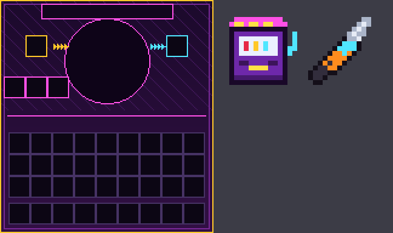

# Моды для Minecraft 1.20.1 (Forge 47.x)

| Файл | Что внутри |
|---|---|
| `absolutum-1.20.1-1.3.0.jar` | **Absolutum** — абсолютное оружие, щит, инструменты, Разрушитель Реальности, Корона |
| `jackpotind-1.20.1-1.1.0.jar` | **Jackpot Industries** — Апгрейд-автомат «Джекпот» и Тоннельный бур с настройками |

Моды независимые — можно ставить любой или оба.

## Как скачать и установить
1. Нажми на нужный `.jar` выше → справа кнопка **Download raw file** (значок загрузки).
2. Положи в папку `mods` (CurseForge: три точки возле «Play» → **Open Folder** → `mods`).
3. Удали из `mods` старые `absolutum-…jar`, `absoluteglove-…jar`, `absolutearsenal-…jar`.

---

## Jackpot Industries

### Апгрейд-автомат «Джекпот» — крафт: верстак + 2 земли
ПКМ — открыть. Неоновый автомат с мигающими лампочками и колесом удачи.
1. **СТАВКА** — предмет, которым рискуешь.
2. **ЦЕЛЬ** — нажми на окошко, выбери приз в каталоге всех предметов (с поиском, и из модов тоже); −/+ — количество (с Shift по 10).
3. **БОНУСЫ** — три слота для любых предметов и блоков: их ценность прибавляется, шанс растёт.
4. **КРУТИТЬ** — колесо делает 5 оборотов и останавливается: стрелка на зелёном — ДЖЕКПОТ, на красном — МИМО.
Шанс = (ставка + бонусы) / цель, максимум 95%. Ставка и бонусы сгорают в любом случае.

**Режим «Свой %»** (кнопка под «КРУТИТЬ»): ты сам ставишь шанс кнопками −/+ (шаг 5%, с Shift — 1%),
например 10, 15, 20, 30, 50% — а автомат сам считает, сколько приза положено.
Чем ниже шанс — тем больше приз. Если приз не выбран, **улучшается твой же предмет**:
положил 10 алмазов на 25% — при выигрыше получишь ~38. ПКМ по окошку цели — сбросить выбранный приз.

**Секретные апгрейды:** при каждом выигрыше с шансом 10% срабатывает секретный бонус —
приз умножается на **×2** (часто), **×3**, **×5** или **×10** (очень редко). Колесо и лампочки
вспыхивают радугой, а в чат приходит сообщение.

### Тоннельный бур — крафт: 2 земли + 2 палки
ПКМ — пробить тоннель. **Shift+ПКМ — настройки прямо в игре:**
- **Что ломать:** категории (земля, камень, песок, растения, деревья, незер, энд, снег/лёд, руды),
  **свои блоки** — выбираешь любые блоки из списка с поиском, или режим **«Ломать всё»**
  (кроме бедрока и неразрушимых блоков);
- **Длина** тоннеля 1–128, **ширина** 1–9, **высота** 1–9;
- **Режим:** вглубь (по взгляду) или по поверхности (горизонтально на уровне ног);
- **Добыча:** исчезает (не грузит компьютер) / в инвентарь / на землю;
- **Убирать воду и лаву**, **не трогать сундуки** (по умолчанию включено), **звук**.
У каждого бура свои настройки — можно держать несколько под разные задачи.

### Достижения
Jackpot Industries · Азартный игрок · Фортуна улыбнулась · Казино всегда в плюсе · ДЖЕКПОТ! ·
Тайный бонус · Десятикратный! · Сам себе крупье ·
Подземный рабочий · Инженер · Метро своими руками · Крот-миллионер

---

## Absolutum
| Предмет | Что делает | Крафт (без формы) |
|---|---|---|
| Перчатка Абсолюта | убивает любого моба с одного удара | земля + земля |
| Абсолютный меч | убивает любого моба с одного удара | земля + палка |
| Абсолютный щит | защита от любого урона, пока в любой руке | земля + доски |
| Абсолютная кирка | мгновенно ломает всё, что ломается киркой | земля + 2 палки |
| Абсолютный топор | мгновенно ломает всё, что ломается топором | земля + бревно |
| Абсолютная лопата | мгновенно ломает всё, что ломается лопатой | земля + 3 палки |
| Абсолютная мотыга | мгновенно ломает всё, что ломается мотыгой | 2 земли + палка |
| Разрушитель Реальности | ЛКМ ломает **любой** блок (даже бедрок) и кладёт его в инвентарь | 3 земли |
| Корона Абсолюта | шлем: все полезные эффекты на максимум, пока надета | 4 земли |

Предметы не ломаются и не горят в лаве; своя вкладка «Absolutum» в творческом режиме.
Бур и Апгрейдер переехали в **Jackpot Industries**.

## Исходники
`source/` — Absolutum, `source-jackpot/` — Jackpot Industries. Сборка: `./gradlew build` (JDK 17).
